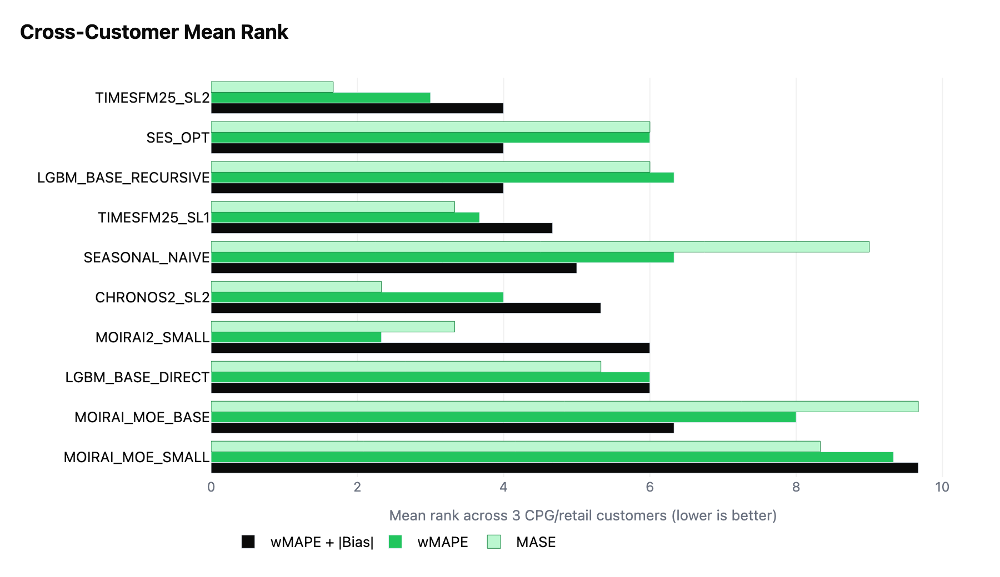

# Foundation Model Benchmark

Zero-shot time series foundation models benchmarked against basic statistical and ML baselines on three large CPG real-world datasets. 

## Findings

Foundation models should mixed results when compared against SES and basic tabular recursive models, but TimesFM2.5 shows promise with a tie in WMAPE + |BIAS| and strong MASE ranking. 
In general, other foundation models seem to struggle with intermittency and lumpy demand found in demand datasets. All FMs show a strong negative bias that could disqualify them from production use-case in our industry. 

## Models

### Foundation Models

| Model | Source | Context Length | Notes |
|-------|--------|---------------|-------|
| `TIMESFM25_SL1` | `darts` — `TimesFM2p5Model` | 1× season_length | Short context: 1 year of weekly history, 1 year of monthly history |
| `TIMESFM25_SL2` | `darts` — `TimesFM2p5Model` | 2× season_length | Long context: ~2 years of weekly or monthly history |
| `CHRONOS2_SL2` | `darts` — `Chronos2Model` | 2× season_length | Long context variant of Amazon Chronos 2 |
| `MOIRAI2_SMALL` | `uni2ts` — `Salesforce/moirai-2.0-R-small` | 1000 steps | Moirai 2 small, fixed context window |
| `MOIRAI_MOE_BASE` | `uni2ts` — `Salesforce/moirai-moe-1.0-R-base` | 200 steps | Moirai Mixture-of-Experts base |
| `MOIRAI_MOE_SMALL` | `uni2ts` — `Salesforce/moirai-moe-1.0-R-small` | 200 steps | Moirai Mixture-of-Experts small |

All foundation models are run zero-shot — no fine-tuning on client data.

### ML Baselines

| Model | Source | Objective | Strategy | Estimators | Leaves |
|-------|--------|-----------|----------|-----------|--------|
| `LGBM_BASE_RECURSIVE` | `mlforecast` (Nixtla) | Tweedie (power=1.5) | Recursive | 100 | 90 |
| `LGBM_BASE_DIRECT` | `mlforecast` (Nixtla) | Tweedie (power=1.5) | Direct | 100 | 90 |

Features: lag features, rolling windows, and date encodings derived automatically from data frequency (weekly: lags 1–26, windows [4,13,26,52]; monthly: lags 1–12, windows [3,6,9,12]).

### Statistical Baselines

| Model | Source | Parameters |
|-------|--------|-----------|
| `SES_OPT` | `statsforecast` (Nixtla) — `SimpleExponentialSmoothingOptimized` | α optimized via SSE |
| `SEASONAL_NAIVE` | `statsforecast` (Nixtla) — `SeasonalNaive` | season_length per client |

## Customers

Results cover three anonymized enterprise CPG/retail clients (SKU-level demand planning) evaluated on held-out cross-validation windows.

| Customer | Series | Eval Horizon | Profile |
|----------|--------|-------------|---------|
| Customer A | 2,796 | 9-12 weeks ahead | Weekly |
| Customer B | 9,271 | 5 steps ahead | Monthly |
| Customer C | 6,281 | 9-12 periods | Weekly |

## Overall Ranking

Mean rank of each model's per-customer rank across the 3 CPG/retail clients (lower is better). `TIMESFM25_SL2`, `SES_OPT`, and `LGBM_BASE_RECURSIVE` tie at the top (4.00) — `TIMESFM25_SL2` wins the tiebreak on mean wMAPE rank, putting a zero-shot foundation model effectively #1 on the cross-customer composite.

| Model | Mean Composite Rank | Mean wMAPE Rank | Mean MASE Rank | Mean \|Bias\| Rank |
|---|---|---|---|---|
| `TIMESFM25_SL2` | 4.00 | 3.00 | 1.67 | 4.33 |
| `SES_OPT` | 4.00 | 6.00 | 6.00 | 5.67 |
| `LGBM_BASE_RECURSIVE` | 4.00 | 6.33 | 6.00 | 4.33 |
| `TIMESFM25_SL1` | 4.67 | 3.67 | 3.33 | 5.33 |
| `SEASONAL_NAIVE` | 5.00 | 6.33 | 9.00 | 3.00 |
| `CHRONOS2_SL2` | 5.33 | 4.00 | 2.33 | 5.00 |
| `MOIRAI2_SMALL` | 6.00 | 2.33 | 3.33 | 6.33 |
| `LGBM_BASE_DIRECT` | 6.00 | 6.00 | 5.33 | 7.00 |
| `MOIRAI_MOE_BASE` | 6.33 | 8.00 | 9.67 | 6.00 |
| `MOIRAI_MOE_SMALL` | 9.67 | 9.33 | 8.33 | 8.00 |

Source: [`data/cross_customer_mean_ranks.csv`](data/cross_customer_mean_ranks.csv).

## Metrics

- **wMAPE** — weighted mean absolute percentage error (primary accuracy metric)
- **Bias** — signed error; negative = systematic under-forecast
- **wMAPE + |Bias|** — composite rank metric penalizing both error and systematic bias
- **MASE** — mean absolute scaled error (scale-independent cross-client comparison, using Insample Naive Forecast)

## Source Packages

| Package | Used For | Reference |
|---------|----------|-----------|
| [`darts`](https://github.com/unit8co/darts) | TimesFM 2.5, Chronos 2 model wrappers | Unit8 |
| [`sktime`](https://github.com/sktime/sktime) | Foundation model Panel scitype interface | sktime community |
| [`uni2ts`](https://github.com/SalesforceAIResearch/uni2ts) | Moirai / Moirai-MoE inference | Salesforce AI Research |
| [`statsforecast`](https://github.com/Nixtla/statsforecast) | SES_OPT, Seasonal Naive | Nixtla |
| [`mlforecast`](https://github.com/Nixtla/mlforecast) | LGBM recursive and direct models | Nixtla |
| [`lightgbm`](https://github.com/microsoft/LightGBM) | Gradient boosting backend | Microsoft |
