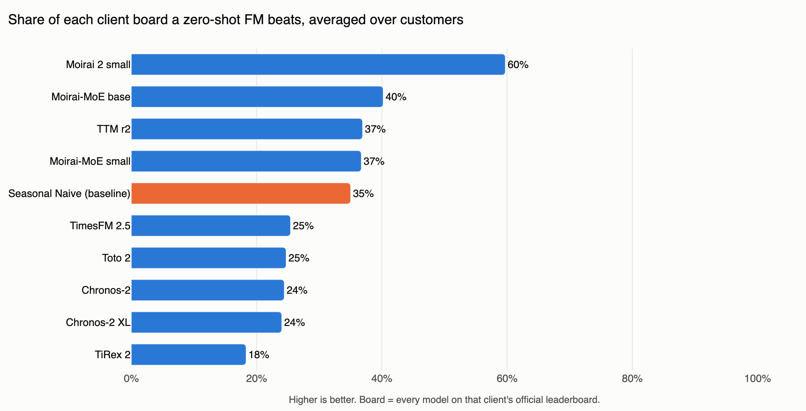

# Foundation Model Benchmark

Nine zero-shot time series foundation models, scored on seven real CPG and retail demand boards, against everything else we run on those boards.

Last refreshed 2026-11-05. Rerun `scripts/pull_boards.py` and `scripts/make_chart.py` to refresh.

## Findings

**Moirai 2 small is the only foundation model that clearly earns its place.** On average it beats 60% of each client's full leaderboard, it is the best FM on five of the seven boards, and it has the smallest \|bias\| of any FM. On Customer G it lands #3 of 48, a hair behind the best tuned model. Its weak spot is Customer E (#74 of 115).

**Most foundation models do not beat a seasonal naive.** TimesFM 2.5, Chronos-2, Chronos-2 XL, Toto 2 and TiRex 2 all average below the seasonal naive baseline across customers, and the Moirai-MoE models and TTM r2 only edge past it. On Customer F the seasonal naive is #2 of 77; no FM gets near it.

**The bias problem from the first round is still there.** TimesFM 2.5, Chronos-2, TiRex 2 and TTM r2 under-forecast on every single board (mean net bias -15% to -33%). The Moirai-MoE models go the other way and over-forecast on most boards. Every board ranks on accuracy plus absolute bias, so this is what sinks most FMs, not raw error.



Source: [`data/cross_customer.csv`](data/cross_customer.csv).

## Cross-customer summary

Board percentile is a model's rank on a client's official leaderboard divided by the number of models on that board (every tuned statistical, ML and deep learning model we run, not just the FMs). Lower is better; the chart shows `1 - percentile`, the share of the board a model beats.

| Model | Boards | Mean board percentile | Mean rank in this roster | Mean \|bias\| | Mean net bias | Boards under-forecast | Max fill share |
|---|---|---|---|---|---|---|---|
| Moirai 2 small | 7/7 | 0.40 | 2.3 | 20.3% | -2.9% | 6 | 7.5% |
| Moirai-MoE base | 7/7 | 0.60 | 4.7 | 26.1% | +18.4% | 2 | 9.2% |
| TTM r2 | 7/7 | 0.63 | 4.6 | 22.2% | -15.3% | 7 | 7.5% |
| Moirai-MoE small | 7/7 | 0.63 | 5.7 | 28.5% | +21.7% | 1 | 9.2% |
| *Seasonal Naive (baseline)* | 7/7 | 0.65 | 5.6 | 15.3% | -2.4% | 5 | 7.5% |
| TimesFM 2.5 | 7/7 | 0.75 | 6.0 | 28.6% | -24.9% | 7 | 6.2% |
| Toto 2 | 7/7 | 0.75 | 5.3 | 30.3% | -10.2% | 6 | 9.2% |
| Chronos-2 | 7/7 | 0.76 | 6.3 | 28.9% | -24.3% | 7 | 6.1% |
| Chronos-2 XL | 7/7 | 0.76 | 6.6 | 29.0% | -17.6% | 6 | 9.2% |
| TiRex 2 | 7/7 | 0.82 | 8.0 | 34.7% | -32.5% | 7 | 9.2% |

\|bias\| is each board's own bias measure (most average \|bias\| per snapshot, so over- and under-forecast months do not cancel). Net bias is signed: negative means under-forecast.

## Per customer

| Customer | Grain | Scored lead | Board size | Best FM (rank) | Seasonal naive rank | Best FM vs board #1 (rank metric) |
|---|---|---|---|---|---|---|
| A | Weekly | weeks 9 to 12 | 177 | Moirai 2 small (#95) | #158 | 0.746 vs 0.634 |
| B | Monthly | month 5 | 126 | TiRex 2 (#44) | #64 | 1.462 vs 1.139 |
| C | Weekly | weeks 9 to 12 | 205 | Moirai 2 small (#44) | #178 | 0.493 vs 0.393 |
| D | Weekly | fiscal month +2 | 119 | Moirai 2 small (#27) | #36 | 0.328 vs 0.285 |
| E | Weekly | week 3 | 115 | Moirai-MoE base (#38) | #112 | 0.475 vs 0.449 |
| F | Monthly | month 2 | 77 | Moirai 2 small (#24) | #2 | 0.129 vs 0.218 (higher is better) |
| G | Monthly | month 1 | 48 | Moirai 2 small (#3) | #47 | 0.703 vs 0.681 |

Full per-customer scorecards (every roster model with WMAPE, \|bias\|, net bias, RMSE, fill share and board rank): [`data/scorecards/`](data/scorecards/).

## Models

All foundation models run zero-shot: pretrained weights, no fine-tuning on client data, the same code on every customer.

| Model | Weights | Notes |
|---|---|---|
| TimesFM 2.5 | Google `timesfm-2.5-200m-pytorch` | context capped at two seasonal cycles |
| Chronos-2 / Chronos-2 XL | Amazon `chronos-2` (XL: larger checkpoint) | |
| TiRex 2 | NX-AI `TiRex-2` | run on CPU kernels (see below) |
| Toto 2 | Datadog `Toto-2.0-22m` | median of the quantile output |
| Moirai 2 small | Salesforce `moirai-2.0-R-small` | mean of the forecast distribution |
| Moirai-MoE base / small | Salesforce `moirai-moe-1.0-R-base` / `-small` | mean of the forecast distribution |
| TTM r2 | IBM `granite-timeseries-ttm-r2` | |
| Seasonal Naive (baseline) | statsforecast `SeasonalNaive` | season 52 weeks / 12 months |

## How it is scored

- **Every number comes from the official scoring gate**, the same locked, versioned leaderboard every model at Daybreak is ranked on. Nothing in this repo recomputes a metric; `scripts/pull_boards.py` only reads the gate's leaderboard views.
- **Each customer ranks by its own business metric**, agreed with that customer's team: weighted accuracy plus absolute bias at the lead time that matters to them. Customer F ranks by WMAPA (higher is better).
- **The gate rejects incomplete runs.** A model that skips a scored series is either rerun or, when the skipped rows carry at most 5% of the scored volume, filled from history (zero for series with no recent sales, otherwise a recent mean or last sale). The **fill share** column shows how much of each score is filled. Most fills are new or dormant items no model can forecast from history.
- **Board size** counts every model admitted to that board, including our tuned production candidates, so percentiles are comparable across customers of very different leaderboard sizes.

## What changed since the July 2026 round

- **Seven customers instead of three**, all scored by the locked gate instead of ad hoc queries.
- **Each customer's own ranking metric.** July ranked everyone on one generic wMAPE + \|bias\| composite. Each board now ranks by the metric agreed with that customer (see below), so July ranks and these ranks are not directly comparable.
- **New models:** Chronos-2 XL, TiRex 2, Toto 2 and TTM r2. Moirai models now report the mean of their forecast distribution.
- **Dropped:** MASE (not part of any customer's ranking) and the two plain LightGBM baselines (each board's #1 tuned model is the stronger reference now).
- **Fixes found along the way:** Toto 2 returned NaN for whole panels when any series had gaps, and ran out of memory on large customers; TiRex 2 GPU kernels no longer compile on current Triton, so it runs on CPU; TTM ran one series per forward pass on CPU and now runs batched on GPU (checked against the reference implementation to 1e-4). These decide whether a model finishes, not what it forecasts.
- **Customer labels:** A, B and C are the same customers as in July. D through G are new.

## Reproduce

```bash
# needs the databricks CLI logged in to the workspace and read access to the scoring catalog
cp .clients.local.json.example .clients.local.json   # map Customer labels to scoring schemas (kept out of git)
python3 scripts/pull_boards.py    # data/scorecards/*.csv, data/cross_customer.csv
python3 scripts/make_chart.py     # data/cross_customer_chart.png
```
